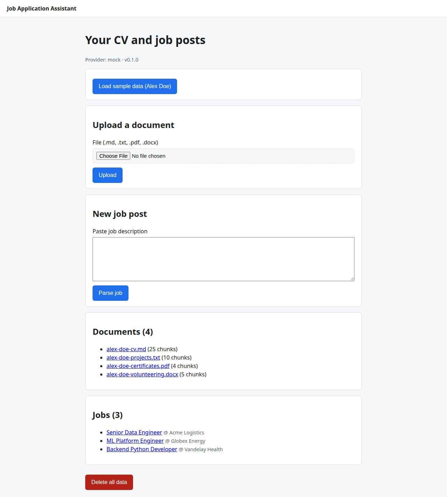
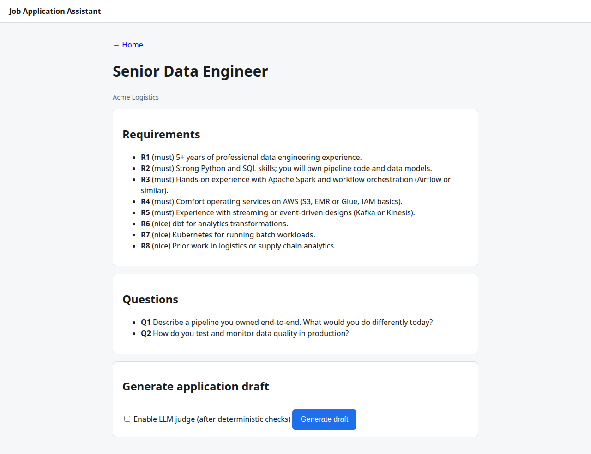
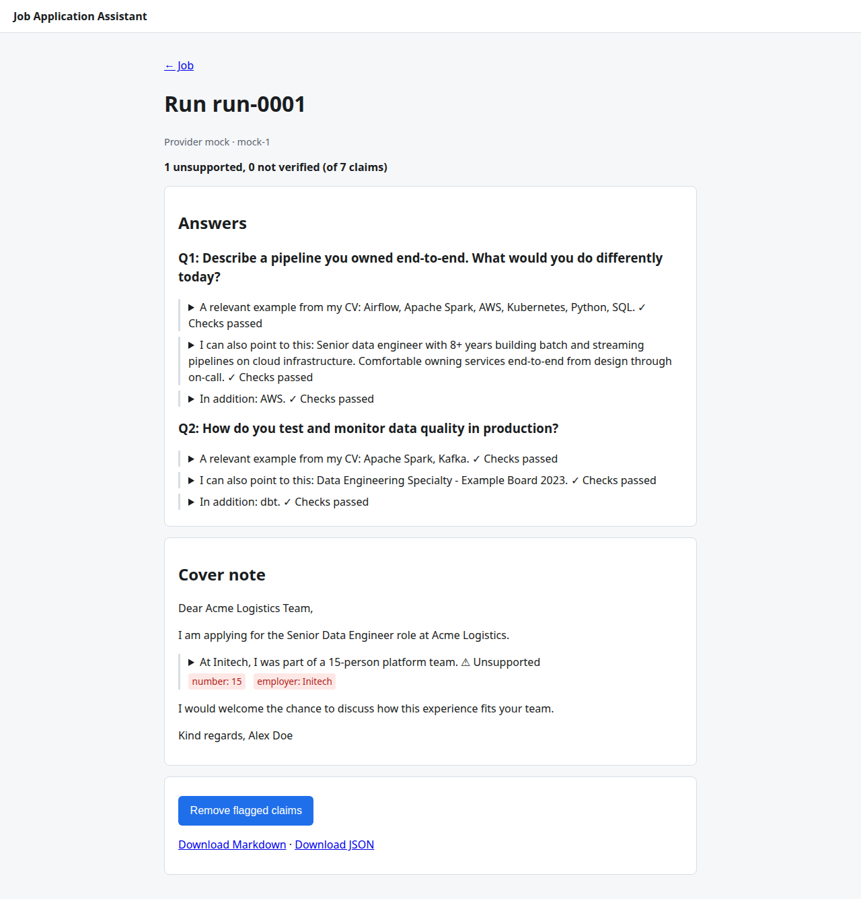
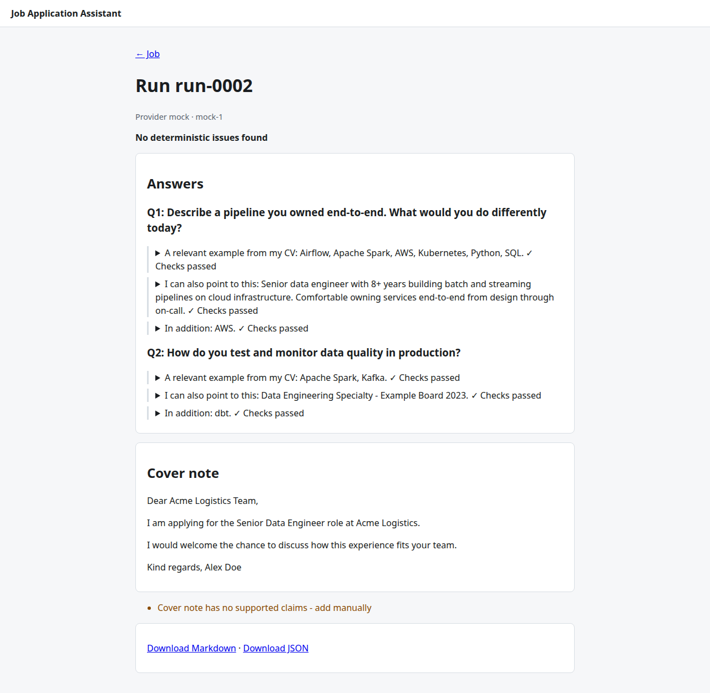
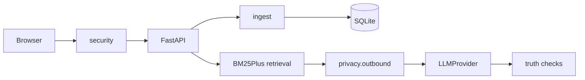

# job-application-assistant

[](https://github.com/applycoding/job-application-assistant/actions/workflows/ci.yml)


Open-source **portfolio demo** by [Arpan Bom](https://github.com/applycoding) ([@applycoding](https://github.com/applycoding)). Tutorials: [applycoding.com](https://applycoding.com).

Tailored job applications from *your* CV, where every claim is cited and checked.

## Screenshots

| Home | Job |
| --- | --- |
|  |  |

| Run (unsupported claim) | Run (after prune) |
| --- | --- |
|  |  |

## Features

- Stable line-level chunk ids and local SQLite storage
- BM25Plus retrieval with term eligibility first and per-term gap reporting
- Citations, explanations, and four-level truthfulness verdicts (`checks_passed`, `entailed`, `unsupported`, `not_verified`)
- Prune flagged claims without another LLM call
- Default **mock** provider (deterministic, offline) for demos and CI

## Privacy

- Your data is stored locally; with a real provider, the selected evidence and the job post are sent to that provider.
- With `JAA_PROVIDER=mock` (the default), nothing leaves your machine.
- **What will be sent** shows the exact outbound JSON before a real-provider run.
- Emails, phones, URLs and street addresses are redacted by regex in outbound payloads. This is best-effort **redaction**, not anonymisation. Contact lines are never retrieved or sent.
- OpenAI and xAI requests use `store=false`; vendor terms apply.
- No telemetry. Payloads, headers and keys are never logged.
- Deletion is logical. **Delete all data** also runs `VACUUM`. It is not forensic erasure.
- Never commit your real CV; `data/` and `var/` are gitignored.

## Security

Local-only by design: Host allowlist, Origin + CSRF on mutations, strict CSP, no CORS. Docker publishes on `127.0.0.1` only. There is no authentication; do not expose the app to a network. Prompt-injection defences (constant system prompts, JSON data boundaries, citation validation) are **mitigations, not immunity**.

## Quickstart (local)

```bash
uv sync
uv run jaa seed
uv run jaa serve
```

Open [http://127.0.0.1:8000](http://127.0.0.1:8000).

## Quickstart (Docker)

```bash
docker build -t jaa .
docker run -p 127.0.0.1:8000:8000 -v jaa-data:/data jaa
```

## Your own documents

Upload in the UI or:

```bash
uv run jaa ingest path/to/cv.md
```

Supported: `.md`, `.txt`, `.pdf`, `.docx` (see `PLAN.md` / `jaa.limits` for caps). Bullet-style CVs with dated role headings work best for duration checks.

## Using a real LLM

```bash
uv sync --extra llm
cp .env.example .env
# set JAA_PROVIDER and the matching API key
```

Models and capability flags live in `src/jaa/resources/providers.toml`. Overrides: `JAA_MODEL`, `JAA_JUDGE_MODEL`, `JAA_JUDGE=on`.

## Architecture



| Module | Role |
| --- | --- |
| `ingest/` | Load, classify, chunk, stable ids |
| `storage/` | SQLModel repository, WAL/FK |
| `jobs/` | Deterministic job parser |
| `retrieval/` | Eligibility, BM25Plus, gaps |
| `privacy/` | Regex redaction, outbound DTO |
| `providers/` | Mock + optional cloud adapters |
| `generation/` | Pipeline, framing templates, explanations |
| `truth/` | Deterministic checks, optional judge, prune |
| `web/` | Jinja2 UI, CSRF, CSP |

## Truthfulness

Each **claim** (not framing) is checked against cited evidence using deterministic rules (numbers, employers, skills, negation, mixed citations, durations, and more). Optional LLM judge runs only on claims that pass deterministic checks. `checks_passed` means no deterministic issue was found, not that the claim is guaranteed true.

The mock provider injects one unsupported claim (`At Initech, I was part of a 15-person platform team.`) so you can see the checker in action.

Limitations: lexicon-based skills, English only, regex extractors, judge can be wrong.

## Configuration

See `.env.example` for all `JAA_*` variables and defaults.

## Development

```bash
uv run ruff check .
uv run mypy src tests
uv run pytest
uv run playwright install chromium
uv run pytest -m e2e
```

Regenerate goldens: `JAA_UPDATE_GOLDEN=1 uv run pytest tests/integration/test_pipeline.py`

## Tutorial

Step-by-step chapters: [`docs/tutorial/`](docs/tutorial/) (00-12).

## Sample data

Alex Doe and all employers in `samples/` are **fictional**. CV and project files use `FICTIONAL SAMPLE DATA` markers; job posts use a portfolio-demo banner. `PLAN.md` line 1309 shows an em dash in the Alex Doe marker text; tracked sample files use an ASCII hyphen instead (see `scripts/check_repo.py`).

## License

MIT © [Arpan Bom](https://github.com/applycoding).
